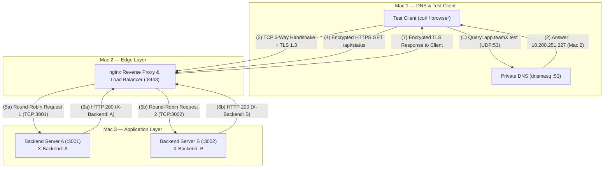

# Private Network Service Platform

A bare-metal, multi-tier distributed network service platform deployed across a physical Local Area Network (LAN) using macOS nodes. This project demonstrates core computer networking principles including **Private DNS Resolution**, **Transport Layer Handshakes (TCP)**, **Cryptographic Session Negotiation (TLS 1.2/1.3)**, **Layer 7 Reverse Proxying & Load Balancing**, and **HTTP Caching**.

---

## 📑 Table of Contents

- [1. Architectural Overview](#1-architectural-overview)
- [2. Multi-Node Deployment & Role Matrix](#2-multi-node-deployment--role-matrix)
- [3. Network Topology](#3-network-topology)
- [4. Protocol Stack & Port Allocation](#4-protocol-stack--port-allocation)
- [5. End-to-End Request Lifecycle](#5-end-to-end-request-lifecycle)
- [6. Key Architectural Principles](#6-key-architectural-principles)
- [7. Project Structure](#7-project-structure)
- [8. Setup & Deployment Guide](#8-setup--deployment-guide)
  - [Mac 1: Private DNS & Test Client](#mac-1-private-dns--test-client)
  - [Mac 2: Edge Reverse Proxy & TLS Ingress](#mac-2-edge-reverse-proxy--tls-ingress)
  - [Mac 3: Dual Backend Microservices](#mac-3-dual-backend-microservices)
- [9. Verification & Testing Playbook](#9-verification--testing-playbook)
- [10. Protocol Capture & Evidence Catalog](#10-protocol-capture--evidence-catalog)
- [11. Phase 2 Key Deliverables & Reports](#11-phase-2-key-deliverables--reports)
- [12. Faculty Demonstration Playbook](#12-faculty-demonstration-playbook)
- [13. Troubleshooting & Diagnostics Matrix](#13-troubleshooting--diagnostics-matrix)

---

## 1. Architectural Overview

The platform partitions standard web service infrastructure across three dedicated physical machines connected to a flat LAN subnet:

```
  ┌─────────────────────────────────────────────────────────────────────────┐
  │                         Shared Local Area Network                       │
  └─────────────────────────────────────────────────────────────────────────┘
          │                                  │                     │
          ▼                                  ▼                     ▼
┌──────────────────┐               ┌──────────────────┐  ┌──────────────────┐
│      Mac 1       │               │      Mac 2       │  │      Mac 3       │
│ (10.200.251.106) │               │ (10.200.251.227) │  │ (10.200.251.76)  │
├──────────────────┤               ├──────────────────┤  ├──────────────────┤
│ • Primary DNS    │  (1) UDP 53   │ • Primary Ingress│  │ • Backend A      │
│   (dnsmasq)      │──────────────>│ • TLS 1.3 Term.  │  │   (Node.js :3001)│
│ • Standby Edge   │  (2) TCP 8443 │ • Round-Robin    │  │ • Backend B      │
│   (nginx :8443)  │──────────────>│   Load Balancer  │  │   (Node.js :3002)│
│ • Test Client    │               │ • Backup DNS     │  │ • PF Anchor Prep │
│   (curl/browser) │               │   (dnsmasq :53)  │  │ • IP Whitelist   │
└──────────────────┘               └─────────┬────────┘  └────────▲─────────┘
                                             │ (3) HTTP Forward   │
                                             └────────────────────┘
```

1. **Private Name Resolution & High Availability DNS**: Mac 1 hosts authoritative Primary DNS (`dnsmasq`), while Mac 2 provides Backup DNS. Upstream clients query with sub-second failover.
2. **Secure Edge Ingress & Standby Redundancy**: Mac 2 acts as Primary Edge Gateway terminating TLS over port `8443` using locally trusted PKI certificates. Mac 1 provides an automated Standby Edge proxy on port `8443`.
3. **Layer 7 Load Balancing & Upstream Failover**: Ingress traffic is balanced across two isolated upstream Node.js services hosted on Mac 3 (`:3001` and `:3002`) using Round-Robin scheduling and passive health checks (`max_fails=1 fail_timeout=10s`).
4. **Multi-Layer Access Control**: Backend services enforce strict IP whitelisting in Express middleware (`ALLOWED_IPS`: `10.200.251.106`, `10.200.251.227`, `127.0.0.1`), backed by kernel-level scoped Packet Filter (`pfctl`) rules.

---

## 2. Multi-Node Deployment & Role Matrix

| Node | Machine Role | Core Software / Runtimes | Network Interfaces & Ports | Description |
| :--- | :--- | :--- | :--- | :--- |
| **Mac 1** (Mihika / Member 1) | • Primary DNS Server<br>• Standby Edge Ingress<br>• Client Test Node | `dnsmasq`, `nginx`, `curl`, `dig`, `openssl` | `en0` (`10.200.251.106`)<br>UDP `53` (Primary DNS)<br>TCP `8443` (Standby Edge)<br>Outbound Client | Authoritative primary resolver for `app.teamX.test`; Standby reverse proxy for high availability; validation client. |
| **Mac 2** (Priyanshu / Member 3) | • Primary Edge Ingress<br>• TLS Terminator<br>• Load Balancer<br>• Backup DNS Server | `nginx` (Homebrew), `dnsmasq`, `mkcert` | `en0` (`10.200.251.227`)<br>TCP `8443` (Primary TLS)<br>TCP `8080` (HTTP Redirect)<br>UDP `53` (Backup DNS) | Primary LAN edge gateway terminating TLS and proxying requests to Mac 3; Backup DNS daemon for high availability. |
| **Mac 3** (Saksham / Member 2) | • Upstream Backend A<br>• Upstream Backend B<br>• Ingress Security & PF | Node.js, Express.js, macOS PF (`pfctl`) | `en0` (`10.200.251.76`)<br>TCP `3001` (Backend A)<br>TCP `3002` (Backend B)<br>TCP `5353` (TTL Cache Resolver) | Dual independent microservice instances executing business logic; IP access control; isolated DNS caching resolver. |

---

## 3. Network Topology



---

## 4. Protocol Stack & Port Allocation

### Protocol Breakdown by OSI Layer

| Protocol | OSI Layer | Transport | Port | Scope & Purpose |
| :--- | :--- | :--- | :--- | :--- |
| **DNS** | Application (L7) | UDP | `53` | Translates `app.teamX.test` and `api.teamX.test` to Mac 2's LAN IP without broadcast pollution. |
| **TCP** | Transport (L4) | IP | Dynamic | Connection-oriented, ordered byte-stream delivery with flow control and retransmissions. |
| **TLS 1.2 / 1.3** | Presentation / Session (L6/L5) | TCP | `8443` | Cryptographic session establishment, mutual parameter exchange (ECDHE), and symmetric cipher encryption (AES-GCM). |
| **HTTPS** | Application (L7) | TLS/TCP | `8443` | Secure application payload transfer between Client and Nginx edge. |
| **HTTP / 1.1** | Application (L7) | TCP | `3001`, `3002` | Internal unencrypted communication between Edge Proxy and Upstream Backends. |

### Port Allocation Table

| Service | Target Machine | Port | Transport | Privilege Level | Notes |
| :--- | :--- | :--- | :--- | :--- | :--- |
| `dnsmasq` | Mac 1 | `53` | UDP | `sudo` / Root | Standard DNS listening port on macOS. |
| `nginx` (HTTPS) | Mac 2 | `8443` | TCP | Non-root | High-port TLS ingress avoiding macOS privileged port restrictions. |
| `nginx` (HTTP Redirect)| Mac 2 | `8080` | TCP | Non-root | 301 Permanent Redirect to HTTPS port. |
| Backend Instance A | Mac 3 | `3001` | TCP | User space | Node.js Express server (`0.0.0.0:3001`). |
| Backend Instance B | Mac 3 | `3002` | TCP | User space | Node.js Express server (`0.0.0.0:3002`). |

---

## 5. End-to-End Request Lifecycle

```
Client (Mac 1)            DNS (Mac 1:53)          Edge / Nginx (Mac 2)     Backend A/B (Mac 3)
     |                          |                          |                       |
     |--- (1) DNS Query ------->|                          |                       |
     |    app.teamX.test (A)    |                          |                       |
     |                          |                          |                       |
     |<-- (2) DNS Answer -------|                          |                       |
     |    IP: MAC2_IP           |                          |                       |
     |                                                     |                       |
     |--- (3) TCP SYN ------------------------------------>|                       |
     |<-- (3) TCP SYN-ACK ---------------------------------|                       |
     |--- (3) TCP ACK ------------------------------------>|                       |
     |                                                     |                       |
     |<=> (4) TLS Handshake (ClientHello / ServerHello) <=>|                       |
     |    (Key Exchange, Certificate Verification)         |                       |
     |                                                     |                       |
     |--- (5) HTTPS Request (Encrypted GET /api/status) -->|                       |
     |                                                     |                       |
     |                                                     |-- (6) Forward HTTP -->|
     |                                                     |   (Round Robin :3001  |
     |                                                     |    or :3002)          |
     |                                                     |                       |
     |                                                     |<- (7) HTTP Response --|
     |                                                     |   (X-Backend: A or B) |
     |                                                     |                       |
     |<-- (8) HTTPS Encrypted Response --------------------|                       |
```

1. **DNS Resolution**: Client queries Mac 1 on UDP port 53. `dnsmasq` evaluates local address rules and returns `MAC2_IP`.
2. **TCP 3-Way Handshake**: Client initiates a connection to `MAC2_IP:8443` exchanging `SYN` $\rightarrow$ `SYN-ACK` $\rightarrow$ `ACK`.
3. **TLS Session Negotiation**: Over the TCP socket, the client issues `ClientHello` with SNI `app.teamX.test`. Nginx responds with `ServerHello` and its certificate. The client verifies the certificate against its local trusted CA and completes key exchange.
4. **Ingress Decryption & Upstream Routing**: Nginx receives encrypted HTTP data, terminates TLS, and selects an upstream backend according to Round-Robin distribution.
5. **Backend Processing**: Node.js processes the route, adds `X-Backend: A` (or `B`) and `Cache-Control: public, max-age=60`, returning HTTP 200 OK.
6. **Encrypted Egress Delivery**: Nginx encrypts the HTTP response within the TLS tunnel and dispatches it over TCP to the client.

---

## 6. Key Architectural Principles

- **No Insecure Bypasses (`curl -k` Forbidden)**: The platform implements full PKI chain verification. Local root CAs generated via `mkcert` are installed in the macOS system trust store, ensuring strict cryptographic verification with zero SSL warnings.
- **Isolated Upstream Topology**: Client nodes are strictly isolated from backend ports (`3001`, `3002`). Backend applications only bind to internal interfaces and are shielded behind the reverse proxy.
- **RFC 6761 Compliant Namespace**: Uses the reserved `.test` Top-Level Domain (TLD) to avoid collisions with macOS mDNS (`.local`) and live internet registries.
- **Stateless Layer 7 Distribution**: Round-Robin scheduling balances load evenly between backend microservices without sticky sessions, providing predictable horizontal scalability.

---

## 7. Project Structure

```
.
├── README.md                          # Root Project Documentation (This file)
├── architecture/                      # Architecture Specifications & Design Documents
│   ├── ip-service-table.md            # Host IP, Interface, MAC & Port mapping table
│   ├── phase-1-requirements.md        # Requirement gates & verification checklists
│   ├── request-flow.md                # Protocol flow specifications & sequence diagrams
│   └── topology.md                    # 3-Machine network topology details
├── backend/                           # Upstream Backend Microservices
│   ├── backend-a/                     # Node.js Service A (Port 3001, Header: X-Backend: A)
│   │   ├── package.json
│   │   └── server.js
│   └── backend-b/                     # Node.js Service B (Port 3002, Header: X-Backend: B)
│       ├── package.json
│       └── server.js
├── config/                            # Infrastructure Configuration Files
│   ├── README.md                      # Detailed config setup instructions
│   ├── dnsmasq.conf                   # Private DNS daemon configuration
│   ├── nginx.conf                     # Reverse proxy, TLS & Upstream load balancer config
│   └── tls-setup.md                   # Step-by-step local CA & PKI generation guide
└── evidence/                          # Network Packet Captures & Verification Artifacts
    ├── backend/                       # Direct backend HTTP proof (Backend-A, Backend-B)
    ├── caching/                       # HTTP Cache-Control header verification
    ├── dns/                           # DNS query/response Wireshark capture
    ├── load-balancing/                # Round-robin distribution request alternating proof
    ├── tcp/                           # TCP 3-Way Handshake SYN/SYN-ACK/ACK capture
    └── tls/                           # TLS 1.3 ClientHello, Handshake & Application Data captures
```

---

## 8. Setup & Deployment Guide

### Prerequisites

- **macOS** on all 3 nodes connected to the same Wi-Fi / Ethernet LAN.
- **Homebrew** package manager installed.
- **Node.js** (v18+) installed on Mac 3.

---

### Mac 1: Private DNS & Test Client

1. **Install dnsmasq**:
   ```bash
   brew install dnsmasq
   ```

2. **Configure DNS Records**:
   Edit `config/dnsmasq.conf` and update the IP addresses with Mac 2's LAN IP:
   ```conf
   address=/app.teamX.test/10.200.251.227
   address=/api.teamX.test/10.200.251.227
   ```

3. **Start dnsmasq** (runs on privileged port 53):
   ```bash
   sudo dnsmasq -C /path/to/computer-network-project/config/dnsmasq.conf -d
   ```

4. **Configure Mac 1 DNS Resolver**:
   ```bash
   sudo networksetup -setdnsservers Wi-Fi 127.0.0.1
   ```

---

### Mac 1: Standby Edge Reverse Proxy (High Availability Ingress)

Mac 1 acts as the **Standby Edge Proxy**, ready to take over ingress traffic if the Primary Edge on Mac 2 (`10.200.251.227`) experiences failure or scheduled maintenance.

#### 1. Installation
```bash
# Install nginx on Mac 1 via Homebrew
brew install nginx

# Verify installation
which nginx       # /opt/homebrew/bin/nginx
nginx -v          # nginx/1.31.9
```

#### 2. Configuration & Backup
The standby configuration is maintained in [`config/nginx-standby.conf`](config/nginx-standby.conf), mirroring Mac 2's upstream load balancing and passive failover:
- **Upstreams**: Backend A (`10.200.251.76:3001`) and Backend B (`10.200.251.76:3002`)
- **Passive Health Checks**: `max_fails=1 fail_timeout=10s`
- **Failover Directive**: `proxy_next_upstream error timeout invalid_header http_500 http_502 http_503 http_504;`
- **Port**: `8443 ssl`
- **Virtual Hosts**: `app.teamX.test` and `api.teamX.test`

Backup default live nginx config:
```bash
cp /opt/homebrew/etc/nginx/nginx.conf /opt/homebrew/etc/nginx/nginx.conf.backup
```

#### 3. TLS Certificate Requirements
Standby edge requires the shared project certificate matching Mac 2:
1. Ensure certificate directory exists on Mac 1:
   ```bash
   mkdir -p /opt/homebrew/etc/nginx/certs
   ```
2. Securely transfer the dual-SAN certificate and private key from Mac 2:
   ```bash
   scp priyanshu@10.200.251.227:/opt/homebrew/etc/nginx/certs/app-and-api.teamX.test.pem /opt/homebrew/etc/nginx/certs/
   scp priyanshu@10.200.251.227:/opt/homebrew/etc/nginx/certs/app-and-api.teamX.test-key.pem /opt/homebrew/etc/nginx/certs/
   chmod 600 /opt/homebrew/etc/nginx/certs/app-and-api.teamX.test-key.pem
   ```
3. Trust root CA on Mac 1:
   ```bash
   sudo security add-trusted-cert -d -r trustRoot -k /Library/Keychains/System.keychain rootCA.pem
   ```

#### 4. Service Management (Start, Reload, Stop)
```bash
# Validate configuration syntax
nginx -t -c /opt/homebrew/etc/nginx/nginx-standby.conf

# Start Standby Edge in foreground / daemon
nginx -c /opt/homebrew/etc/nginx/nginx-standby.conf

# Reload configuration after changes
nginx -s reload -c /opt/homebrew/etc/nginx/nginx-standby.conf

# Stop Standby Edge
nginx -s stop -c /opt/homebrew/etc/nginx/nginx-standby.conf
```

#### 5. Validation Commands
```bash
# Validate HTTPS endpoint
curl -i https://app.teamX.test:8443/health
curl -i https://api.teamX.test:8443/api/status

# Verify round-robin upstream distribution
for i in {1..4}; do
  curl -s -I https://app.teamX.test:8443/health | grep -i "x-backend"
done
```

#### 6. Rollback Instructions
```bash
# Stop standby nginx
nginx -s stop 2>/dev/null

# Restore original default configuration
cp /opt/homebrew/etc/nginx/nginx.conf.backup /opt/homebrew/etc/nginx/nginx.conf
```

---

### Mac 2: Edge Reverse Proxy & TLS Ingress

1. **Install nginx & mkcert**:
   ```bash
   brew install nginx mkcert nss
   ```

2. **Generate TLS Certificates**:
   ```bash
   # Initialize local Root CA
   mkcert -install

   # Generate certificate for the project domains
   mkcert app.teamX.test api.teamX.test

   # Place certificate and key in nginx directory
   mkdir -p /opt/homebrew/etc/nginx/certs
   mv app.teamX.test*.pem /opt/homebrew/etc/nginx/certs/
   chmod 600 /opt/homebrew/etc/nginx/certs/app.teamX.test-key.pem
   ```

3. **Install Root CA on Client Nodes (Mac 1 & Mac 3)**:
   - Export root CA from Mac 2: `mkcert -CAROOT` (`rootCA.pem`).
   - Copy `rootCA.pem` to Mac 1 and Mac 3.
   - Trust CA on client:
     ```bash
     sudo security add-trusted-cert -d -r trustRoot -k /Library/Keychains/System.keychain rootCA.pem
     ```

4. **Deploy nginx Configuration**:
   - Update `config/nginx.conf` upstream block with Mac 3's LAN IP:
     ```nginx
     upstream backend_servers {
         server 10.200.251.76:3001;   # Backend A
         server 10.200.251.76:3002;   # Backend B
     }
     ```
   - Copy configuration and start nginx:
     ```bash
     cp config/nginx.conf /opt/homebrew/etc/nginx/nginx.conf
     nginx -t
     nginx
     ```

---

### Mac 3: Dual Backend Microservices

#### Phase 2 Service Management & Automation Scripts

Mac 3 hosts **Backend A** (`:3001`) and **Backend B** (`:3002`), featuring independent process controls, health endpoints, IP whitelisting, and automated failover testing:

1. **Start Both Backend Services**:
   ```bash
   ./backend/start-all.sh
   ```

2. **Check Backend Health**:
   ```bash
   ./backend/health-check.sh
   ```

3. **Independent Control (for Failover Demos)**:
   ```bash
   # Backend A (Port 3001)
   ./backend/start-a.sh
   ./backend/stop-a.sh

   # Backend B (Port 3002)
   ./backend/start-b.sh
   ./backend/stop-b.sh
   ```

4. **Stop All Backend Services**:
   ```bash
   ./backend/stop-all.sh
   ```

5. **Automated Failover & Recovery Verification**:
   ```bash
   ./backend/test-backend-failover.sh
   ```

6. **Backend Access Security (Requirement C)**:
   - **Application-Layer**: Inbound requests to ports `3001` and `3002` are strictly restricted by Express IP middleware to authorized nodes:
     - Mac 1 (Standby Edge): `10.200.251.106`
     - Mac 2 (Primary Edge): `10.200.251.227`
     - Local Loopback: `127.0.0.1`
     - Unauthorized clients receive `HTTP 403 Forbidden`.
   - **Network-Layer (Packet Filter `pfctl`)**: Scoped rules are available in `config/pf_backend.rules` and backup in `config/pf.conf.backup`.
     ```bash
     # Load scoped backend anchor without flushing main system rules
     sudo pfctl -a backend -f config/pf_backend.rules

     # Rollback / remove backend anchor
     sudo pfctl -a backend -F all
     ```

---

## 9. Verification & Testing Playbook

Execute these commands from **Mac 1** (Client Node) to validate the end-to-end network deployment:

### 1. DNS Resolution Validation

```bash
dig @127.0.0.1 app.teamX.test
```
*Expected Result:* `ANSWER SECTION` returns Mac 2's IP (`10.200.251.227`).

---

### 2. Strict TLS & HTTPS Verification (No `-k` Flag)

```bash
curl -i https://app.teamX.test:8443/api/status
```
*Expected Result:*
```http
HTTP/2 200 
x-backend: A
cache-control: public, max-age=60
content-type: application/json; charset=utf-8

{"backend":"A","status":"ok"}
```
> **Notice:** Request must complete without any SSL certificate error or insecure warning.

---

### 3. Round-Robin Load Balancing Verification

Execute 4 sequential requests to verify alternating backend routing:

```bash
for i in {1..4}; do
  echo "--- Request $i ---"
  curl -s -I https://app.teamX.test:8443/api/status | grep -i "x-backend"
done
```

*Expected Result:*
```
--- Request 1 ---
x-backend: A
--- Request 2 ---
x-backend: B
--- Request 3 ---
x-backend: A
--- Request 4 ---
x-backend: B
```

---

### 4. HTTP Caching Headers Verification

```bash
curl -I https://app.teamX.test:8443/api/status | grep -i "cache-control"
```
*Expected Result:* `Cache-Control: public, max-age=60`

---

## 10. Protocol Capture & Evidence Catalog

The [`evidence/`](evidence/) directory contains packet captures, diagnostic logs, and verification reports taken during live multi-node test executions:

| Category | Evidence File | Verified Protocol Concept / Scope |
| :--- | :--- | :--- |
| **DNS** | [`evidence/dns/DNS-Captured.jpg`](evidence/dns/DNS-Captured.jpg) | UDP Port 53 DNS query for `app.teamX.test` and A record resolution. |
| **TCP** | [`evidence/tcp/tcp-three-way-handshake.jpg`](evidence/tcp/tcp-three-way-handshake.jpg) | Standard 3-Way Handshake (`SYN` $\rightarrow$ `SYN-ACK` $\rightarrow$ `ACK`) on port `8443`. |
| **TLS** | [`evidence/tls/tls-client-hello.jpg`](evidence/tls/tls-client-hello.jpg) | TLS `ClientHello` frame with SNI `app.teamX.test` and cipher suite proposals. |
| **TLS** | [`evidence/tls/TLS-overview.jpg`](evidence/tls/TLS-overview.jpg) | Complete TLS cryptographic exchange overview and certificate validation. |
| **TLS** | [`evidence/tls/tls-encrypted-application-data.jpg`](evidence/tls/tls-encrypted-application-data.jpg) | Encrypted Application Data frames protecting HTTP payloads over the wire. |
| **Load Balancing**| [`evidence/load-balancing/Load-balancing .jpg`](evidence/load-balancing/Load-balancing%20.jpg) | Alternating `X-Backend: A` and `X-Backend: B` headers via Nginx Round-Robin. |
| **Backend Services**| [`evidence/backend/Backend-A.jpg`](evidence/backend/Backend-A.jpg)<br>[`evidence/backend/Backend-B.jpg`](evidence/backend/Backend-B.jpg) | Direct isolated Node.js instance execution on ports `3001` and `3002`. |
| **HTTP Caching** | [`evidence/caching/http-cache-headers.jpg`](evidence/caching/http-cache-headers.jpg) | `Cache-Control` header passthrough at the reverse proxy layer. |
| **Phase 2 Standby Failover** | [`evidence/backend/phase2-standby-backend-failover.md`](evidence/backend/phase2-standby-backend-failover.md) | Coordinated 12/12 test verifying standby edge upstream routing during Backend A and B outages. |
| **Phase 2 DNS TTL Caching** | [`evidence/dns/phase2-dns-ttl-caching.md`](evidence/dns/phase2-dns-ttl-caching.md) | Isolated resolver verifying TTL 30s countdown, cache hits, cache eviction, and upstream re-query. |
| **Phase 2 Backend Verification** | [`evidence/backend/phase2-backend-verification.log`](evidence/backend/phase2-backend-verification.log) | Local health checks, Express IP whitelist verification (HTTP 403), and failover scripts. |
| **Phase 2 Startup Logs** | [`evidence/backend/mac3-backend-startup-verification.log`](evidence/backend/mac3-backend-startup-verification.log) | Daemonized Node.js startup (`PPID 1`), LAN interface bindings (`0.0.0.0`), and PID tracking. |

---

## 11. Phase 2 Key Deliverables & Reports

Detailed technical documentation and team acceptance reports for Phase 2 implementation:

1. **[Phase 2 Final Project Submission Summary](evidence/final/phase2-submission-summary.md)**:
   - Complete executive summary of implementation, testing, passes, unverified items, and limitations.
   - Comprehensive cross-node delivery audit and final Git integrity status.

2. **[Phase 2 Consolidated Final Acceptance & Fault-Injection Matrix](evidence/final/phase2-final-acceptance-test.md)**:
   - 22-point acceptance test matrix across DNS, TCP/Network, TLS/HTTPS, Application, and Edge Failover layers.
   - Detailed status breakdown: 19 PASS (86.4%), 3 NOT VERIFIED (13.6%), 0 FAIL.

3. **[Phase 2 Final System Architecture Specification](architecture/phase2-final-architecture.md)**:
   - Physical and logical 3-Mac network topology (`10.200.251.0/24`).
   - Multi-node role and port allocation matrix, high-availability subsystems, and Mermaid protocol flow.

4. **[Phase 2 Edge Failover and DNS Migration Runbook](evidence/dns/phase2-edge-failover-and-dns-migration.md)**:
   - Exact procedure for migrating traffic from Primary Edge (`10.200.251.227`) to Standby Edge (`10.200.251.106`).
   - DNS record update procedure, 30-second TTL propagation wait, and complete two-way recovery steps.

5. **[Phase 2 Packet Filter (PF) Backend Firewall Verification Report](evidence/backend/phase2-pf-firewall-verification.md)**:
   - Configuration audit of `config/pf_backend.rules` and syntax verification via `pfctl -nf`.
   - Multi-layer defense-in-depth: Express IP whitelist middleware (`ALLOWED_IPS`) and scoped kernel anchor (`-a backend`).
   - Non-destructive safe activation and one-command instant rollback (`sudo pfctl -a backend -F all`).

6. **[Phase 2 Joint Final Acceptance Report](evidence/phase2-final-acceptance-report.md)**:
   - Full synthesis across all 3 nodes and 3 team members.
   - Acceptance criteria verification matrix (Requirements A through F).
   - Component state, IP mappings, port allocations, and runtime health.

7. **[Phase 2 Member 2 Final Report (Saksham — Mac 3)](evidence/phase2-member2-final-report.md)**:
   - Detailed technical report for Backend Services A (`:3001`) and B (`:3002`).
   - Node.js architecture, health endpoints (`GET /health`), lifecycle automation, and daemon persistence.
   - Isolated DNS TTL caching resolver implementation on port `5353`.

8. **[Phase 2 Standby Edge Backend Failover Evidence](evidence/backend/phase2-standby-backend-failover.md)**:
   - 12/12 successful requests through Standby Edge (`10.200.251.106:8443`) during Backend A outage.
   - 12/12 successful requests through Standby Edge during Backend B outage.

9. **[Phase 2 DNS TTL Caching Experiment Report](evidence/dns/phase2-dns-ttl-caching.md)**:
   - Architectural design of isolated `dnsmasq` caching resolver on `127.0.0.1:5353`.
   - Verified timestamps for cache hit, TTL countdown, record update on upstream (`10.200.251.227`), and cache eviction.

---

## 12. Faculty Demonstration Playbook

Follow this step-by-step sequence during project evaluation to verify all platform capabilities:

### Demo 1: High Availability DNS & Automatic Resolver Failover
```bash
# Query Primary DNS on Mac 1
dig @10.200.251.106 app.teamX.test +short
# Output: 10.200.251.227

# Query Backup DNS on Mac 2
dig @10.200.251.227 app.teamX.test +short
# Output: 10.200.251.227

# Simulate Primary DNS failure by stopping dnsmasq on Mac 1, then verify query from client:
# Client automatically falls over to Mac 2 (10.200.251.227) without service interruption.
```

### Demo 2: Strict TLS & Round-Robin Ingress Load Balancing
```bash
# Execute 4 requests against Primary Edge (Mac 2)
for i in {1..4}; do
  curl -s -i --resolve app.teamX.test:8443:10.200.251.227 https://app.teamX.test:8443/api/status | grep -E "HTTP/|x-backend"
done
# Output strictly alternates:
# x-backend: A
# x-backend: B
# x-backend: A
# x-backend: B
```

### Demo 3: Edge Failover to Standby Reverse Proxy (Mac 1)
```bash
# Verify Standby Edge on Mac 1 directly serves requests:
curl -i --resolve app.teamX.test:8443:10.200.251.106 https://app.teamX.test:8443/health
# Output: HTTP/2 200 OK (routed to Mac 3 backend)
```

### Demo 4: Backend Failover & Dynamic Upstream Recovery
```bash
# Step 1: On Mac 3, stop Backend A
./backend/stop-a.sh

# Step 2: From Mac 1 / Mac 2, issue 4 requests
for i in {1..4}; do
  curl -s -i --resolve app.teamX.test:8443:10.200.251.227 https://app.teamX.test:8443/api/status | grep "x-backend"
done
# Output: 100% routed to Backend B (zero failed requests)

# Step 3: On Mac 3, restart Backend A
./backend/start-a.sh

# Step 4: Verify round-robin load balancing immediately resumes
for i in {1..4}; do
  curl -s -i --resolve app.teamX.test:8443:10.200.251.227 https://app.teamX.test:8443/api/status | grep "x-backend"
done
# Output: Alternation between A and B restored.
```

### Demo 5: Backend Access Control & Whitelist Verification
```bash
# On Mac 3, verify local access:
curl -i http://127.0.0.1:3001/health    # HTTP 200 OK

# From authorized edge nodes (Mac 1: 10.200.251.106 or Mac 2: 10.200.251.227):
curl -i http://10.200.251.76:3001/health   # HTTP 200 OK

# From an unauthorized machine or simulated non-whitelisted IP:
# Output: HTTP 403 Forbidden {"error":"Forbidden: Access restricted to authorized edge proxies"}
```

### Demo 6: DNS TTL Countdown & Cache Expiration
```bash
# Query isolated caching resolver on Mac 3 (:5353)
dig @127.0.0.1 -p 5353 ttl-test.teamX.test
# Initial response: TTL 30, Query time: 10-15 msec
# Immediate re-query: TTL 22, Query time: 0 msec (served from cache)
# After 30 seconds: Cache expires, queries upstream Mac 2 and fetches updated record.
```

---

## 13. Troubleshooting & Diagnostics Matrix

| Symptom / Error | Probable Cause | Diagnostic Command | Remediation Step |
| :--- | :--- | :--- | :--- |
| `ping: sendto: No route to host` / `nc: connectx: No route to host` | macOS Sequoia Local Network Privacy (TCC) sandbox restriction | `ping 10.200.251.227` from native Terminal vs sandbox | Run command via native `Terminal.app` or bypass sandboxed subshell. |
| `connect ECONNREFUSED 10.200.251.76:3001` | Backend service stopped or terminated when terminal shell closed | `ps aux \| grep server.js`<br>`lsof -i :3001` | Use detached daemon startup: `nohup node server.js < /dev/null >> "$LOG_FILE" 2>&1 & disown` via `./backend/start-all.sh`. |
| `HTTP 403 Forbidden` from Backend | Client IP is not in Express `ALLOWED_IPS` whitelist | `curl -i http://10.200.251.76:3001/health`<br>Inspect client IP in `server.js` log | Add client IP to `ALLOWED_IPS` array in `backend/backend-a/server.js` and `backend-b/server.js`. |
| `HTTP 502 Bad Gateway` on Edge | Upstream backend processes down or IP misconfigured in Nginx | `curl -i http://10.200.251.76:3001/health`<br>Inspect `/opt/homebrew/var/log/nginx/error.log` | Start backends with `./backend/start-all.sh`; verify upstream block in `nginx.conf` points to `10.200.251.76`. |
| `curl: (60) SSL certificate problem` | Root CA is not trusted on the client machine | `mkcert -CAROOT`<br>`security find-certificate -c "mkcert"` | Import and trust Root CA: `sudo security add-trusted-cert -d -r trustRoot -k /Library/Keychains/System.keychain rootCA.pem`. |
| `dig` returns `connection timed out` on port 53 | `dnsmasq` stopped or firewall blocking UDP 53 | `sudo lsof -i :53`<br>`sudo dscacheutil -flushcache` | Restart dnsmasq on Mac 1 or Mac 2: `sudo brew services restart dnsmasq`. |
| PF syntax error or rule parse error | Invalid pf syntax or misplaced anchor directive | `sudo pfctl -nf config/pf_backend.rules` | Validate rules before loading. Ensure sub-anchors do not use root-only statements. |
| Safe PF Rollback needed | Test completed or need to remove packet filter restrictions | `sudo pfctl -a backend -s rules` | Flush scoped anchor: `sudo pfctl -a backend -F all`. Does not affect system rules. |

---
