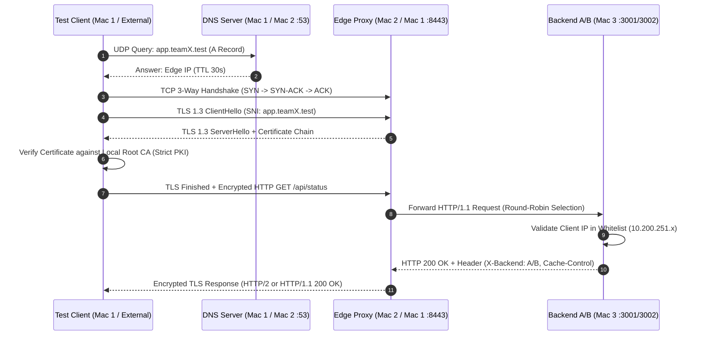

# Phase 2 — Final System Architecture Specification

**Project:** Private Network Service Platform  
**Architecture Version:** Phase 2 (High Availability & Redundancy Release)  
**Date:** 2026-11-23  
**Authors:** Mihika (Member 1), Saksham (Member 2), Priyanshu (Member 3)  

---

## 1. Physical & Logical Network Topology

The platform is deployed across three dedicated physical macOS computers connected to a single flat LAN subnet:

```
                                    Local Area Network Subnet: 10.200.251.0/24
                                    Default Gateway: 10.200.251.184
                                    Primary Network Interface: en0
      ┌───────────────────────────────────────────────┼──────────────────────────────────────────────┐
      │                                               │                                              │
      ▼                                               ▼                                              ▼
┌───────────────────────────┐           ┌───────────────────────────┐          ┌───────────────────────────┐
│     MAC 1 — MIHIKA        │           │    MAC 2 — PRIYANSHU      │          │     MAC 3 — SAKSHAM       │
│     (10.200.251.106)      │           │     (10.200.251.227)      │          │      (10.200.251.76)      │
├───────────────────────────┤           ├───────────────────────────┤          ├───────────────────────────┤
│ • Primary DNS Server      │           │ • Primary Edge Proxy      │          │ • Upstream Backend A      │
│   - dnsmasq (UDP/TCP :53) │           │   - nginx (:8443 TLS)     │          │   - Node.js Express :3001 │
│   - Local TTL: 30 seconds │           │   - HTTP Redirect (:8080) │          │ • Upstream Backend B      │
│ • Standby Edge Proxy      │           │   - Round-Robin LB        │          │   - Node.js Express :3002 │
│   - nginx (:8443 TLS)     │           │   - Passive Health Checks │          │ • Multi-Layer Security    │
│   - Hot Standby Ingress   │           │ • Backup DNS Server       │          │   - Express IP Whitelist  │
│ • Test Client Node        │           │   - dnsmasq (UDP/TCP :53) │          │   - Scoped PF Anchor      │
│   - curl, dig, browser    │           │   - Local TTL: 30 seconds │          │ • TTL Caching Resolver    │
│                           │           │ • PKI Certificate Root    │          │   - dnsmasq :5353         │
└───────────────────────────┘           └───────────────────────────┘          └───────────────────────────┘
```

---

## 2. Multi-Node Role & Port Allocation Matrix

| Node | Machine Role | Services & Runtimes | Network Ports | Scope & Responsibility |
| :--- | :--- | :--- | :--- | :--- |
| **Mac 1** | Primary DNS & Standby Edge | `dnsmasq`, `nginx` 1.31.9, `curl`, `dig` | `UDP/TCP 53` (DNS)<br>`TCP 8443` (Standby HTTPS)<br>`TCP 8080` (Standby Redirect) | Authoritative primary resolver for `.test` domains; warm standby reverse proxy for edge redundancy; client test node. |
| **Mac 2** | Primary Edge & Backup DNS | `nginx` 1.31.6, `dnsmasq`, `mkcert` | `TCP 8443` (Primary HTTPS)<br>`TCP 8080` (Primary Redirect)<br>`UDP/TCP 53` (Backup DNS) | Primary ingress terminating TLS; distributes traffic across upstream backends; provides secondary authoritative DNS. |
| **Mac 3** | Dual Backend Microservices & Ingress Security | Node.js (v18+), Express.js, macOS PF (`pfctl`) | `TCP 3001` (Backend A)<br>`TCP 3002` (Backend B)<br>`TCP 5353` (TTL Cache Resolver) | Hosts application microservices; enforces client IP whitelisting; prepares packet filter firewall; hosts isolated caching resolver. |

---

## 3. High Availability Subsystems

### A. Dual DNS High Availability
- **Primary DNS (Mac 1 — `10.200.251.106`):** Standard authoritative resolver resolving `app.teamX.test` and `api.teamX.test` to Primary Edge (`10.200.251.227`).
- **Backup DNS (Mac 2 — `10.200.251.227`):** Synchronized secondary resolver running independently. Both servers advertise an authoritative `local-ttl=30` seconds.
- **Failover Characteristics:** If Mac 1 becomes unreachable, client queries to Mac 2 respond in 0ms with identical records.

### B. Dual Edge Proxy Redundancy
- **Primary Ingress (Mac 2):** Terminates TLS using local PKI certificates (`app-and-api.teamX.test.pem`) and balances HTTP traffic between `10.200.251.76:3001` and `10.200.251.76:3002`.
- **Standby Ingress (Mac 1):** Configured identically with the same certificates, upstream health checks, and timeouts. In the event of Mac 2 maintenance, DNS records are migrated to point to Mac 1.

### C. Upstream Passive Failover & Recovery
- Both Nginx instances implement open-source passive health monitoring:
  ```nginx
  upstream backend_servers {
      server 10.200.251.76:3001 max_fails=1 fail_timeout=10s;
      server 10.200.251.76:3002 max_fails=1 fail_timeout=10s;
  }
  ```
- If either backend fails or crashes, Nginx catches the error via `proxy_next_upstream error timeout http_502 http_503` and forwards the request to the alternate healthy backend without dropping client traffic (100% request success rate).
- Once the failed backend recovers, Nginx automatically restores Round-Robin alternation after the 10-second `fail_timeout` expires.

### D. Multi-Layer Access Control
- **Application Layer (L7):** Express middleware inspects the incoming socket `req.socket.remoteAddress` against `ALLOWED_IPS = ['127.0.0.1', '10.200.251.106', '10.200.251.227']`. Unauthorized callers receive `HTTP 403 Forbidden`.
- **Network Layer (L4):** Scoped macOS Packet Filter rules (`config/pf_backend.rules`) loaded under anchor `backend` restrict incoming TCP packets on ports 3001/3002 to `<authorized_edges>`, dropping unauthorized packets at the kernel TCP layer.

---

## 4. End-to-End Request Protocol Flow



---

## 5. Verification & Compliance Standard

The system strictly adheres to the following constraints:
1. **Zero SSL Warnings (`no -k` flag):** All test commands validate certificates strictly against the trusted Root CA installed in `/Library/Keychains/System.keychain`.
2. **Deterministic Name Resolution:** Operates entirely within the RFC 6761 reserved `.test` top-level domain.
3. **Daemon Process Persistence:** All Node.js backend processes on Mac 3 are fully decoupled from interactive shells (`nohup` + `< /dev/null` + `disown` + `PPID 1`).
4. **Scoped Non-Destructive Firewalls:** PF rules operate strictly inside sub-anchors (`-a backend`), eliminating any risk of flushing system rules or disrupting host connectivity.
